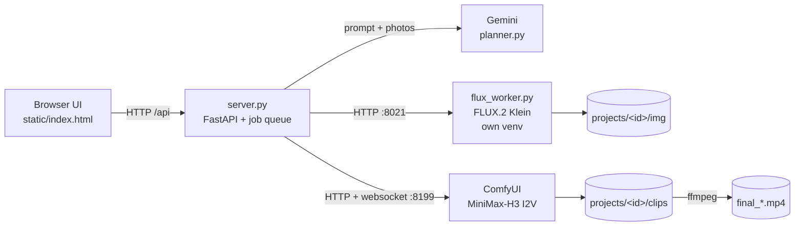

# Storyboard Studio

## What is this?

A web app that turns a text prompt into a short video, one 5-second scene at a time.
Gemini writes a storyboard. FLUX draws the first frame of every scene. You fix the frames and prompts in the browser.
Then MiniMax-H3 animates each frame into a clip, and the clips are joined into one video.

## Why?

Video models are slow and expensive per clip. Fixing a bad frame **before** rendering video saves a lot of GPU time.
Here you see and approve every first frame (regenerate, edit, upload your own, undo/redo, add or remove scenes),
and you can edit the exact prompt the video model gets.

---

## Quick start

All commands run from `/mnt/newdisk/neel/video_gen_test`.

**1. Put your Gemini key in a `.env` file** (skip if `product_video/.env` already has it — the studio reads that file too).

```bash
echo "GEMINI_API_KEY=<YOUR_GEMINI_KEY>" > storyboard_studio/.env
```

Replace `<YOUR_GEMINI_KEY>` with your key from Google AI Studio.

**2. Start the server.** ⚠️ Starts a web server and, later, uses the GPU heavily (FLUX + MiniMax-H3).

```bash
.venv/bin/python storyboard_studio/server.py
```

**3. Open the UI** at `http://<SERVER_IP>:7870` (replace `<SERVER_IP>` with this machine's IP, or `localhost`).

**4. Make a video**
1. Write a prompt, pick a duration (5 s per scene) and aspect (16:9 or 9:16).
   Optionally upload up to 4 reference photos (your product, a model) and say what each one is.
2. Press **Create storyboard**. Gemini writes the scenes, then FLUX draws each first frame (a few seconds per image).
3. Fix what you don't like (see [Using the editor](#using-the-editor)).
4. Press **Render final video**. Download it from the player at the top of the project.

> The first clip after a server restart waits ~10 minutes while the video model loads its weights from truenas.
> After that a clip takes about 2.5–3 minutes, and unchanged scenes are not rendered again.

To run it in the background (survives closing the terminal):

```bash
setsid nohup .venv/bin/python storyboard_studio/server.py > storyboard_studio/server.log 2>&1 < /dev/null &
```

To stop it:

```bash
kill $(ss -ltnp | grep ':7870' | grep -o 'pid=[0-9]*' | cut -d= -f2)
```

---

## How it works

1. **Plan** — `planner.py` sends your prompt (and reference photos) to Gemini. Gemini returns N scenes.
   Each scene has an **image prompt** (what the first frame looks like) and a **video prompt** (what moves, the camera, the sound).
2. **Draw** — `flux_worker.py` runs FLUX.2 Klein and renders every first frame at the video size (1344×768 or 768×1344).
   If a scene uses reference photos, FLUX gets them as reference images, so the product looks like yours.
3. **Edit** — you change images and prompts in the browser. Every change is saved in `projects/<id>/project.json`.
4. **Animate** — `video.py` sends each approved image + video prompt to ComfyUI, which runs MiniMax-H3 image-to-video
   (the image is the clip's first frame). One clip = 124 frames at 24 fps ≈ 5.2 s, with sound.
5. **Join** — `video.py` joins the clips with a 0.25 s crossfade (with or without sound) into `final_<time>.mp4`.

### Architecture



**One GPU, two models.** FLUX and MiniMax-H3 do not fit on the 46 GB GPU together.
All GPU work goes through **one job queue** (one job at a time). Before an image job the server tells ComfyUI to unload;
before a video job it tells the FLUX worker to move to CPU RAM. Switching takes seconds, not a full reload.

### Example data flow

Input: prompt *"10 second premium commercial for this navy steel watch: dark studio light-sweep reveal, then a hero shot on wet black slate"*,
duration 10 s, one reference photo labelled *"the navy steel watch (product)"*.

1. `POST /api/projects` saves the photo to `projects/<id>/refs/` and queues a **plan** job. 10 s / 5 s = 2 scenes.
2. Gemini returns 2 scenes, e.g. scene 1 image prompt *"…close-up of the watch from the reference image… a narrow beam of light…"*,
   video prompt *"0-2s: a cool beam sweeps across the crystal… camera slow push-in… Audio: …"*, `refs: [1]`.
3. Two **image** jobs run FLUX → `img/<scene>_<random>.png`.
4. You click **Edit image…** → *"make the light beam warmer, golden"* → a new image; the old one goes to Undo history.
5. **Render final video** → a **final** job renders each scene's clip into `clips/<hash>.mp4`, then joins them → `final_074332.mp4` (15 s with 3 scenes).

---

## Using the editor

Per scene card:

| Control | What it does |
|---|---|
| **Regenerate** | New image from the image prompt (new random seed). Saves unsaved prompt text first. |
| **Edit image…** | Type an instruction (*"make the background darker"*). FLUX edits the current image and keeps the composition. |
| **Upload** | Use your own picture as the first frame. It is cropped to the video size. |
| **Undo / Redo** | Step back and forward through this scene's images. Nothing is deleted. |
| **use photo N** | Which reference photos FLUX must include in this frame. |
| **Image prompt** | Text for the first frame. Saved when you click outside the box. |
| **Video prompt** | Text sent to the video model (motion, camera, sound). Saved when you click outside the box. |
| **Render this clip** | Render only this scene, to preview it. |
| **↑ ↓ ✕** | Move the scene, or delete it. |
| **+ add scene here** | Give an idea → Gemini writes a scene that fits between its neighbours and FLUX draws it. **Add blank** adds an empty scene. |

Project bar: **Video quality**, **Sound** (with sound / silent), **Render final video**.

| Quality | What it uses | Time per 5 s clip (L40S, warm) |
|---|---|---|
| **Final 768p** (default) | 4-step Turbo LoRA v1.0, Comfy Kitchen INT8 attention | ~70 s short prompt, ~100 s with Gemini's long prompts |
| **Fast 768p** | Final + sol-attn sparse attention | ~10 s faster, slightly further from full quality |
| **Draft 544p** | Final at lower resolution | ~34 s short prompt |
| **High quality 8-step** | 8-step Turbo LoRA v1.0, dense attention | ~137 s short prompt — most natural skin, hair and identity |

The numbers come from `bench/bench_video.py` (results in `bench/results.jsonl`). The 4-step v1.2 LoRA was tested and not used:
it looked softer and drifted in colour.

**Tip:** editing an image does not change the video prompt. If you change the look (e.g. blue light → golden light),
also change the video prompt, or the video model will move back toward the old description.

### Progress panel

The bar under the header shows the running job and its scene, the video-model phase
(*loading text encoder → sampling step 2/4 → decoding → saving*), elapsed time and ETA, the queue,
and the last 10 finished jobs with their time or error. Click **details** to see the queue and history.

---

## Requirements

| What | Details |
|---|---|
| GPU | NVIDIA, ~45 GB VRAM for MiniMax-H3 (tested on L40S 46 GB). Nothing else should hold the GPU while rendering. |
| RAM | ~100 GB used during video rendering (tested with 125 GB). |
| System tools | `ffmpeg` and `ffprobe` on PATH. |
| Main venv | `video_gen_test/.venv` (Python 3.11): ComfyUI + `requirements.txt`. |
| FLUX venv | `/mnt/newdisk/neel/Text_to_image_model/venv` (Python 3.12): see `requirements-flux.txt`. |
| ComfyUI | `video_gen_test/ComfyUI`, with `extra_model_paths.yaml` pointing at the truenas model folders. |
| Model weights (truenas) | `/mnt/truenas/video_gen_models/ComfyUI-MiniMax-H3/`: `diffusion_models/minimax_h3_fl2va_pruned_fp8_scaled.safetensors`, `loras/minimax_h3_fl2v_turbo_4step_v1.0_768p_comfyui_bf16.safetensors`, a text encoder (`qwen3vl_32b_minimax_h3_int8_convrot` or `_bf16`), a video VAE (`minimax_h3_video_vae_int8_convrot` or `_fp16`), `vae/minimax_h3_audio_vae_fp32.safetensors`. FLUX: `/mnt/truenas/image_model/flux_model`. |
| API key | Gemini (`GEMINI_API_KEY`). |

### Installation (only if the venvs do not exist yet)

See the install order at the top of `requirements.txt` (venv → torch → ComfyUI packages → this file).
⚠️ These commands install packages.

```bash
uv pip install --python .venv/bin/python -r storyboard_studio/requirements.txt
```

The int8 text encoder and VAE are optional (they make the first load about twice as fast). To download them to truenas:

```bash
.venv/bin/python download_te_int8.py
```

⚠️ Downloads ~30 GB to `/mnt/truenas/video_gen_models/ComfyUI-MiniMax-H3/`. The studio uses them automatically once they exist.

---

## Configuration

Set these in `storyboard_studio/.env` or in the shell before starting the server.

| Variable | Default | Meaning |
|---|---|---|
| `GEMINI_API_KEY` | — (required) | Gemini key. Also read from `product_video/.env`. |
| `GEMINI_MODEL` | `gemini-2.5-flash` | Gemini model used for planning. |
| `STUDIO_HOST` | `0.0.0.0` | `0.0.0.0` = reachable from other machines on the network (no login!). Use `127.0.0.1` for this machine only. |
| `STUDIO_PORT` | `7870` | Web UI port. |
| `FLUX_PYTHON` | `/mnt/newdisk/neel/Text_to_image_model/venv/bin/python` | Python of the FLUX venv. |
| `FLUX_PORT` | `8021` | Local port of the FLUX worker. |
| `FLUX_MODEL` | `/mnt/truenas/image_model/flux_model` | FLUX weights folder (read by `flux_worker.py`). |
| `COMFY_PORT` | `8199` | ComfyUI port (started automatically if not running). |

---

## Folder structure

```
storyboard_studio/
├── server.py            # FastAPI app: API endpoints, project storage, the single GPU job queue, progress
├── planner.py           # Gemini: plan the storyboard, write one new scene for "add scene here"
├── flux_worker.py       # FLUX.2 Klein image server (runs in the FLUX venv, started by server.py)
├── video.py             # ComfyUI MiniMax-H3 image-to-video, clip cache, weight pre-read, progress websocket, final join
├── static/index.html    # the whole UI (HTML + CSS + plain JavaScript)
├── requirements.txt     # packages for the main venv
├── requirements-flux.txt# packages for the FLUX venv
└── projects/<id>/       # created at runtime (one folder per video)
    ├── project.json     #   prompt, settings, scenes (prompts, current image, undo/redo, clip)
    ├── refs/            #   your uploaded reference photos
    ├── img/             #   every first-frame image ever made (undo history points here)
    ├── clips/           #   rendered clips, named by a hash of image + prompt + settings
    └── final_*.mp4      #   joined videos
```

It also reuses `../product_video/generate.py` to start ComfyUI (with sage attention) and to talk to it.

## How the code works

- **`server.py`**
  - `create()` saves the photos, creates `project.json`, queues a `plan` job.
  - `worker()` is one background thread that takes jobs from the queue one by one: `plan`, `fill` (add scene), `image`, `clip`, `final`.
  - `use_gpu("image" | "video")` moves the other model off the GPU before a job.
  - `gen_image()` builds the FLUX request (normal or edit), then saves the old image into the undo history.
  - `gen_clip()` computes the clip hash; if `clips/<hash>.mp4` exists it reuses it, otherwise it renders.
  - `render_final()` renders missing clips (again, if you edited scenes during the render), then joins them.
  - `progress()` (`GET /api/progress`) reports the current job, phase, step, ETA, queue and history.
- **`video.py`**
  - `make_clip()` copies the image into ComfyUI and sends the MiniMax-H3 graph (fp8 model + 4-step Turbo LoRA, 4 steps). It retries up to 3 times with a new seed.
  - `clip_key()` hashes image bytes + video prompt + quality + aspect + seed. Same inputs → same file → no re-render.
  - `progress_listener()` follows ComfyUI's websocket for the node being run and the sampling step.
  - `prefetch()` reads the video weights once at startup, so they are in RAM before the first render.
  - `stitch()` joins clips with ffmpeg crossfades.
- **`planner.py`** asks Gemini for typed JSON (via a pydantic schema) and retries up to 8 times with growing waits (5 s → 60 s), because Gemini sometimes answers `503 high demand`.

### API endpoints (used by the UI)

| Method + path | Purpose |
|---|---|
| `POST /api/projects` | New project (form: `brief`, `seconds`, `aspect`, `labels`, `files`) |
| `GET /api/projects`, `GET /api/projects/{id}` | List / read projects |
| `PATCH /api/projects/{id}` | `quality` (`final`/`draft`), `sound` (true/false) |
| `PATCH /api/projects/{id}/scenes/{sid}` | Change `image_prompt`, `video_prompt`, `refs` |
| `POST …/scenes/{sid}/image` | `{"mode":"regenerate"}` or `{"mode":"edit","instruction":"…"}` |
| `POST …/scenes/{sid}/upload` | Upload your own frame (`file`) |
| `POST …/scenes/{sid}/undo`, `…/redo` | Step through image history |
| `POST /api/projects/{id}/scenes` | Add a scene (`after`, `idea`) |
| `DELETE …/scenes/{sid}`, `POST …/scenes/{sid}/move` | Delete / move (`{"dir": -1 or 1}`) |
| `POST …/scenes/{sid}/clip` | Render one clip |
| `POST /api/projects/{id}/render` | Render all clips and join them |
| `GET /api/progress` | Live progress |
| `GET /files/{id}/…` | Images, clips and final videos |

---

## Common errors and fixes

| What you see | Likely cause | Fix |
|---|---|---|
| `GEMINI_API_KEY is empty` | No key in `storyboard_studio/.env` or `product_video/.env` | Add `GEMINI_API_KEY=…` and restart the server. |
| Planning takes minutes, or `Gemini planning failed… 503 UNAVAILABLE` | Gemini is overloaded | The planner already retries 8 times. Wait and press Create again. |
| `FLUX worker exited` | FLUX venv path wrong, or GPU out of memory | Read `storyboard_studio/flux_worker.log`. Check `FLUX_PYTHON`. |
| First clip "stuck" on *loading text encoder* or *sampling 0/4* for many minutes | One-time load of ~70 GB of weights from truenas | Normal after a restart. Later clips are fast. The int8 text encoder halves this. |
| Clip fails with CUDA out of memory | Another program is using the GPU (e.g. a vLLM server) | Check `nvidia-smi`, stop the other GPU job, render again. |
| `every scene needs an image first` | A scene has no image yet | Generate or upload an image for that scene. |
| `scenes kept changing during the render` | Scenes were edited during 3 render passes | Stop editing, press **Render final video** again (finished clips are reused). |
| Port 7870 already in use | Server already running | Use the running one, or stop it with the `kill` command above. |

Logs: `storyboard_studio/server.log` (API + Python errors), `storyboard_studio/flux_worker.log` (FLUX),
`comfy_app.log` in `video_gen_test/` (ComfyUI, when started by the studio).

---

## How to test

With the server running, from `video_gen_test/`:

**1. The UI answers:**

```bash
curl -s -o /dev/null -w "%{http_code}\n" localhost:7870/
```

Expected: `200`.

**2. Create a 10 s project with a reference photo** (calls Gemini, then FLUX):

```bash
curl -s -F "brief=10 second premium commercial for this watch" -F seconds=10 -F aspect=16:9 \
  -F 'labels=["the watch (product)"]' -F "files=@product_photos/my_custum_test/watch2.png" \
  localhost:7870/api/projects
```

It returns the project JSON. Copy its `"id"`.

**3. Watch it plan and draw:**

```bash
curl -s localhost:7870/api/progress
```

When `current` is `null` and `queue` is empty, open `http://<SERVER_IP>:7870/#<PROJECT_ID>` — every scene should show an image.

**4. Render** (uses the GPU for several minutes):

```bash
curl -s -X POST localhost:7870/api/projects/<PROJECT_ID>/render
```

When done, `GET /api/projects/<PROJECT_ID>` has `"final": "final_<time>.mp4"`, and the file is in `projects/<PROJECT_ID>/`.
Run render again without changes: it finishes in a few seconds because every clip comes from the cache.
